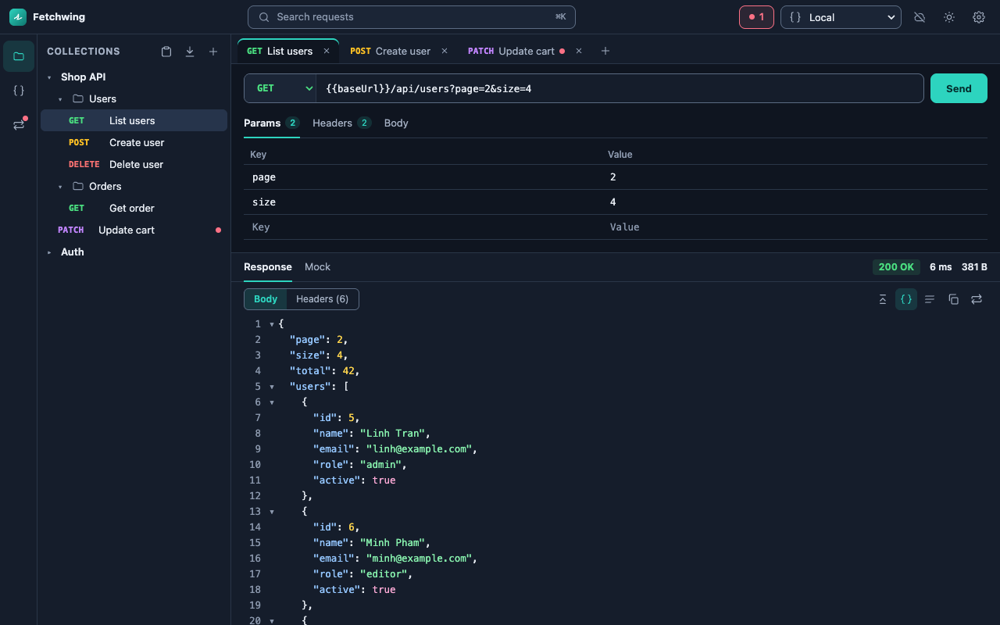

# Fetchwing

A lightweight API client that lives in Chrome DevTools. Paste a cURL command, send it, keep it in a collection, and make web pages get a fixed response while the real API is unfinished or misbehaving.



## Features

- **Paste or import cURL.** Network tab → right-click a request → *Copy as cURL*, then paste. You can also import a file holding several commands.
- **Send from the extension.** You get status, time, size, headers and a foldable JSON viewer. Cookies from the cURL command are sent too.
- **Collections and folders** with drag and drop, open-request tabs and ⌘K / Ctrl+K search.
- **Environments.** Use `{{variables}}` in URLs, headers and bodies. Variables marked *secret* stay on your device.
- **Mocks.** Pages calling the same method and URL (query included, in any order) get the response you set: status, delay, headers and body. Mocks keep working with DevTools closed, and the toolbar badge shows how many are on.
- **Google Drive sync (optional).** Sign in to keep your workspace in one file in your own Drive and use it on other computers. The last edit wins per request, folder or environment.
- Dark and light themes. Narrow and short DevTools layouts are supported.

## Install

- From the Chrome Web Store (link to come once it is published), or
- Load unpacked: clone this repo, open `chrome://extensions`, turn on *Developer mode* → **Load unpacked** → pick the repo folder. Then open DevTools on any page and choose the **Fetchwing** tab.

Fetchwing asks for access to a site the first time you send to it or turn a mock on for it, never for all sites at install.

## Privacy

There is no server, no analytics and no tracking. Data stays in your browser, plus your own Google Drive if you sign in. Read the [privacy policy](https://hduy-dev.github.io/fetchwing/privacy.html).

## Development

```sh
npm test              # unit tests (node --test, no dependencies)
npm run sync          # regenerate src/content/mock-main.js from src/lib/mock-runtime.js
npm run images        # render icons and the Store promo tile
npm run build         # dist/fetchwing-<version>.zip for the Chrome Web Store
```

Publishing steps (OAuth client, Store listing) are in [docs/PUBLISHING.md](docs/PUBLISHING.md).

## License

[MIT](LICENSE)
